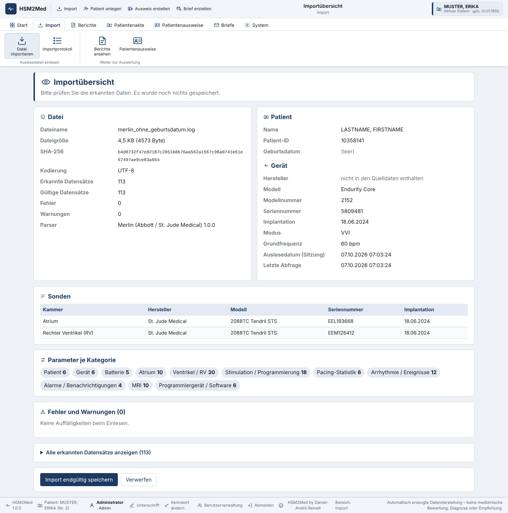
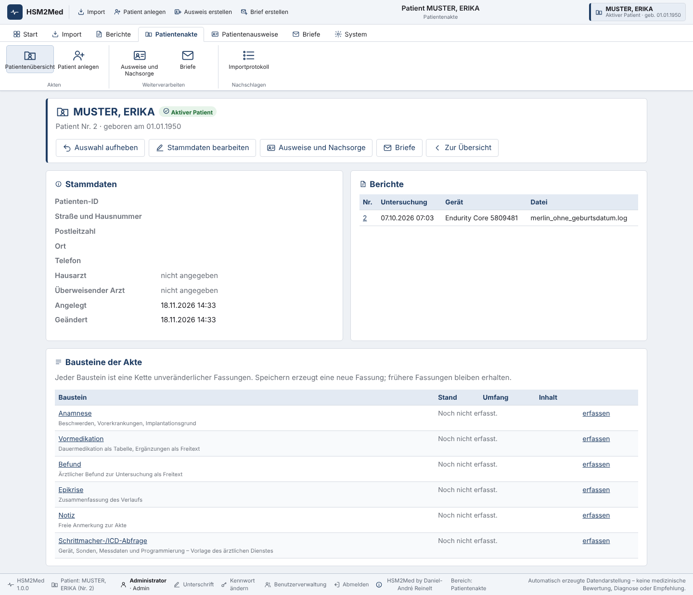

# Code-Review: PR #38 – Biotronik-Import: Patienten zuordnen und Messwerte weiterverarbeiten

| | |
|---|---|
| Pull Request | [#38](https://github.com/dareinelt/HSM2Med/pull/38) (gemergt, Merge-Commit `98f5716`) |
| Anlass | [#37](https://github.com/dareinelt/HSM2Med/issues/37) – „Bericht wird gelesen, importiert und ausgewertet. Geht aber nicht in Brief/Ausweis.“ |
| Geprüfter Stand | `98f5716` |
| Maßstab | Harte Regeln und Konventionen in `agentsindex.md` (§0, §14), Anforderungen in `.agent/main.md` |
| Art | Nachträgliches Review (Code, Tests, visuelle Prüfung); keine Codeänderungen |

## Zusammenfassung

Der gemeldete Fehler aus #37 ist behoben: Ein vor dem Import angelegter Patient wird über
Nachname + Vorname + Geburtsdatum wiederverwendet, es entsteht keine Dublette, und die
Biotronik-Messwerte erscheinen in der Messwerttabelle des Briefes und auf Seite 2 des
Patientenausweises.

Die neue Rückfallregel „aktiver Patient“ ist jedoch zu weit gefasst. Sie greift bereits, wenn
die Identität in der Datei **unvollständig** ist (z. B. fehlendes Geburtsdatum), und ordnet den
Bericht dann ohne Warnung einem anderen Menschen zu. Zusätzlich wird bei mehreren
Identitätstreffern automatisch entschieden. Beides verstößt gegen harte Regel 9
(`agentsindex.md`) und sollte zeitnah korrigiert werden.

| Schwere | Anzahl |
|---|---|
| Hoch | 2 |
| Mittel | 4 |
| Niedrig / Hinweis | 5 |

## Verifikation

- **Testsuite:** `docker compose --profile test run --rm tests` → 574 erfolgreich,
  0 fehlgeschlagen, 9845 Assertions (entspricht der Angabe im PR).
- **Reproduktionstests:** vier zusätzliche Integrationstests außerhalb des Repositorys
  (Randfälle der Patientenzuordnung, siehe H1, H2, M1).
- **Visuelle Prüfung:** frische Dokumentationsinstanz (`docker compose --profile docs`),
  Durchlauf mit Playwright: Patient anlegen → Biotronik-Import → Akte → Brief-Assistent
  (Messwerte) → Ausweis-Assistent → Ausweis-PDF; zusätzlich Import ohne Patientendaten und
  Merlin-Import ohne Geburtsdatum.
- **Biotronik-Codes:** alle 13 neuen IDs in `config/patient_card_measurements.php` gegen die
  Referenzdatei abgeglichen; jeder Code stammt aus dem passenden RV-/Brady-Abschnitt.

## Befunde

### Hoch

#### H1 – Unvollständige Datei-Identität ordnet den Bericht stillschweigend dem aktiven Patienten zu

- **Ort:** `src/Import/ImportService.php`, `upsertPatient()` – Bedingung
  `$id === null && $identityKey === null && $activePatientId !== null`.
- **Problem:** `identityKey` ist schon `null`, wenn nur **eine** der drei Angaben fehlt
  (Geburtsdatum fehlt oder ist nicht lesbar, Name ohne Komma → kein Vorname). Enthält die
  Datei dann eine Patienten-ID, die noch nicht bekannt ist, landet der Bericht beim aktiven
  Patienten – obwohl die Datei einen anderen Namen und eine andere ID nennt. Das Gerät wird
  ebenfalls diesem Patienten zugeordnet, die Patienten-ID aus der Datei wird nirgends
  übernommen.
- **Warnung fehlt:** `ImportValidator` meldet `missing_patient` nur, wenn Name **und** ID
  fehlen. Im beschriebenen Fall zeigt die Vorschau **0 Warnungen**.
- **Regression:** Vor dem PR entstand in diesem Fall ein neuer Patient mit der ID aus der Datei.
- **Reproduktion:** aktiver Patient `MUSTER, ERIKA`; Import von `tests/fixtures/merlin_sample.log`
  mit entferntem Geburtsdatum (Name `LASTNAME, FIRSTNAME`, ID `10358141`) → Bericht und Gerät
  `Endurity Core 5809481` hängen an Erika. Ebenso bei einem Namen ohne Komma.

  

  

- **Verstößt gegen:** harte Regel 9 (Identität nur über Nachname + Vorname + Geburtsdatum),
  `.agent/main.md` §40 („keine Annahmen über nicht explizit vorhandene Daten“).
- **Empfehlung:** Den aktiven Patienten nur verwenden, wenn die Datei **keinerlei**
  Patientenangaben enthält (kein Name, keine ID, kein Geburtsdatum). Bei einer Teil-Identität,
  die nicht eindeutig passt, den Import blockieren oder die Zuordnung dem Benutzer vorlegen;
  eine eigene Warnung (z. B. `incomplete_patient_identity`) ergänzen.

#### H2 – Mehrere Identitätstreffer werden automatisch aufgelöst

- **Ort:** `ImportService::findPatientByIdentity()` – Rückgabe des aktiven Patienten, sonst
  `$ids[0]` (niedrigste ID).
- **Problem:** Gibt es mehrere Patienten mit derselben Identität und ist keiner davon aktiv,
  wird ohne Hinweis der älteste gewählt. Auch der Vorrang des aktiven Patienten ist eine
  implizite Entscheidung ohne Rückfrage.
- **Reproduktion:** zwei Patienten `LASTNAME1, FIRSTNAME1, 25.04.1928`, keiner aktiv →
  Bericht geht an Patient 1, keine Warnung.
- **Verstößt gegen:** harte Regel 9 („bei mehreren Treffern entscheidet der Benutzer“); der
  Index `idx_patients_identity` ist laut `agentsindex.md` gerade deshalb nicht eindeutig.
- **Empfehlung:** Mehrfachtreffer in `analyze()` erkennen, in der Vorschau als blockierenden
  Hinweis mit Auswahl der Kandidaten anzeigen und die Auswahl beim Speichern übergeben.

### Mittel

#### M1 – Patienten-ID bleibt alleiniges Zuordnungsmerkmal

- **Ort:** `ImportService::findPatientByIdentifier()` als Rückfall nach der Identitätssuche.
- **Problem:** Enthält die Datei eine vollständige Identität ohne Treffer, aber eine bekannte
  Patienten-ID, wird der Bericht dem Patienten dieser ID zugeordnet – auch wenn dessen Name
  oder Geburtsdatum abweicht.
- Das Verhalten bestand schon vorher, wird durch den PR aber ausdrücklich festgeschrieben.
- **Verstößt gegen:** harte Regel 9 („Patienten-ID … nie alleiniges Merkmal“).
- **Empfehlung:** Bei abweichender Identität keinen ID-Rückfall, sondern Konflikt melden.

#### M2 – Vorschau zeigt den Zielpatienten nicht

- **Ort:** `templates/import/preview.php`, `ImportController::preview()/commit()`.
- **Problem:** Die Importübersicht zeigt nur die Patientendaten der Datei, nicht, welchem
  Patienten der Datenbank der Bericht zugeordnet wird (Nr., Name, Treffergrund). Beim
  Speichern wird `analyze()` mit dem dann aktiven Patienten neu ausgeführt; wechselt der
  aktive Patient zwischen Vorschau und Speichern (anderer Tab), bestätigt der Benutzer einen
  anderen Zusammenhang als den angezeigten.
- **Empfehlung:** Zielpatient und Treffergrund in `ImportAnalysis` aufnehmen, in der Vorschau
  anzeigen und die Patienten-ID der Vorschau beim Speichern mitsenden und prüfen.

#### M3 – Neues SQL außerhalb von `src/Repository/`

- **Ort:** `findPatientByIdentity()`, `findPatientByIdentifier()`, `patientExists()` in
  `ImportService`.
- **Problem:** `agentsindex.md` §14: „SQL ausschließlich als vorbereitete Statements in
  `src/Repository/`“. `PatientRepository` existiert bereits. `ImportService` enthielt schon
  vorher SQL; der PR erweitert die Abweichung.

#### M4 – Testlücken

Die neuen Tests decken nur Positivfälle ab. Es fehlen:

- unvollständige Identität in der Datei bei gesetztem aktivem Patienten (H1),
- mehrere Identitätstreffer ohne aktiven Patienten (H2),
- bekannte Patienten-ID mit abweichender Identität (M1),
- Meldungstext von `missing_patient` ohne aktiven Patienten.

### Niedrig / Hinweise

- **N1 – Fehlendes Geburtsdatum ohne Warnung:** `ImportValidator` warnt nur bei nicht lesbarem,
  nicht bei fehlendem Geburtsdatum. Das bestand vorher; durch den PR entscheidet das
  Geburtsdatum aber nun über die Zuordnung.
- **N2 – Fachliche Auswahl dokumentieren:** „Wahrnehmung [mV] RV“ verwendet
  `INTR_AMPL_MEAN` (722055); Minimum/Maximum (722054/722053) bleiben unberücksichtigt.
  Vertretbar, sollte aber im README begründet werden. Die Vorlagenversion wurde korrekt auf
  `1.1.0` angehoben.
- **N3 – Brief-Assistent ohne Kammerangabe (bestehend):** Schritt 4 „Messwerte wählen“ zeigt
  RA- und RV-Zeilen ohne Kammer, z. B. zweimal „Impedanz [Ohm]“. Im Ausweis-PDF ist die
  Kammer korrekt ausgewiesen. Nicht durch den PR verursacht, mit Biotronik-Daten (nur RV)
  aber deutlich sichtbar.
- **N4 – Biotronik-Fixture (bestehend):** `tests/fixtures/BIOTRONIC_ANN.xml` ist
  byte-identisch mit `.reference/BIOTRONIC_ANN.xml`. Laut `agentsindex.md` §12 dürfen
  Referenzdaten nie in Tests verwendet werden; die Namen sind Platzhalter, Geräte- und
  Sondenseriennummern sollten geprüft und ggf. anonymisiert werden. Die neuen Tests bauen
  auf dieser Datei auf. Aus diesem Grund enthält dieses Review keine Screenshots mit
  Biotronik-Daten.
- **N5 – Dokumentationsbilder:** Der geänderte Hinweistext der Importvorschau und der
  Biotronik-Ablauf sind in `docs/screenshots` nicht abgebildet.

## Positiv

- Identitätsabgleich über `patients.identity_key` statt über das Rohformat des
  Geburtsdatums – der Kern von #37 ist sauber gelöst und getestet.
- Messwertzuordnung bewusst auf eindeutige Entsprechungen beschränkt; keine Werte erfunden,
  Snapshots bestehender Briefe/Ausweise bleiben unverändert.
- Konfigurationsänderung folgt dem dokumentierten Weg (nur `config/patient_card_measurements.php`,
  `version` erhöht, README und `agentsindex.md` angepasst).

## Ergebnis der visuellen Prüfung

| Ansicht | Ergebnis |
|---|---|
| Importvorschau Biotronik | Daten korrekt; Zielpatient nicht angezeigt (M2) |
| Patientenübersicht nach Import | ein Patient, ein Bericht – keine Dublette (#37 behoben) |
| Brief-Assistent, Schritt 4 | 11 Messwerte mit Werten; Kammerangabe fehlt (N3) |
| Ausweis-PDF, Seite 2 | MOS, 585, 6.0, 4.7/0.4, VVI, 60/50/55, 5.0/1.5, BI/BI korrekt |
| Vorschau ohne Patientendaten | neuer Hinweis „… dem aktiven Patienten zugeordnet“ |
| Merlin-Import ohne Geburtsdatum | 0 Warnungen, Bericht in der Akte des aktiven Patienten (H1) |

## Empfohlene nächste Schritte

1. H1 und H2 beheben (Rückfallregel eng fassen, Mehrfachtreffer dem Benutzer vorlegen),
   inklusive der Tests aus M4.
2. Zielpatient in der Importvorschau anzeigen und beim Speichern absichern (M2).
3. Bereits importierte Berichte auf Fehlzuordnungen prüfen: Berichte, deren
   `patient_name_snapshot`/`patient_identifier_snapshot` nicht zum zugeordneten Patienten
   passen.
4. M1, M3 und die Hinweise N1–N5 in Folgearbeiten aufnehmen.
